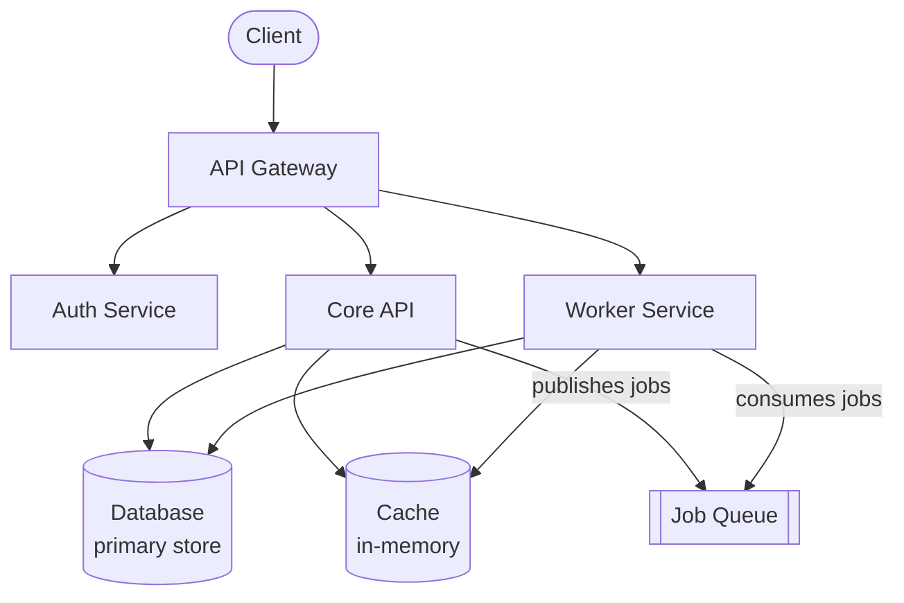

This page gives you a high-level map of our backend services so you can understand the overall system before working in any one repo. Each service has its own README with deeper documentation on configuration, local setup, and deployment specifics.

## Service map

The diagram below shows how requests flow through the system and how services depend on each other.

## Services

### API Gateway

The public-facing entry point for all client traffic. Handles routing, rate limiting, and authentication checks before forwarding requests to downstream services. Deployed on your cloud platform.

**Repo:** `api-gateway`

### Auth Service

Manages user identity, sessions, and permissions. Integrates with your identity provider for SSO. All authentication decisions are delegated here — other services call Auth to validate tokens rather than implementing their own auth logic.

**Repo:** `auth-service`

### Core API

The main application backend. Handles business logic for the primary product domain and owns the primary database.

**Repo:** `core-api`

### Worker Service

Processes background jobs: email delivery, async data processing, scheduled tasks, and webhook delivery. Consumes jobs from the queue published by Core API.

**Repo:** `worker`

## Communication patterns

Understanding how services talk to each other helps you trace requests and debug issues across service boundaries.

- **Synchronous:** Services communicate via internal HTTP APIs. Auth headers are passed through and validated at each service boundary.
- **Asynchronous:** Workers consume from the job queue. The Core API publishes jobs; workers process them independently without blocking the API response.
- **Events:** Significant domain events (user created, subscription changed) are published to the event bus for downstream consumers.

<Note>
  When debugging a cross-service issue, check logs in both the calling service and the downstream service. Auth failures in particular can surface as opaque 500s in upstream services when the real error is a 401 from Auth Service.
</Note>

## Environments

| Environment | Purpose | Access |
|-------------|---------|--------|
| Local | Development | All engineers |
| Staging | Pre-production verification | All engineers |
| Production | Live traffic | Deploy tool only |
